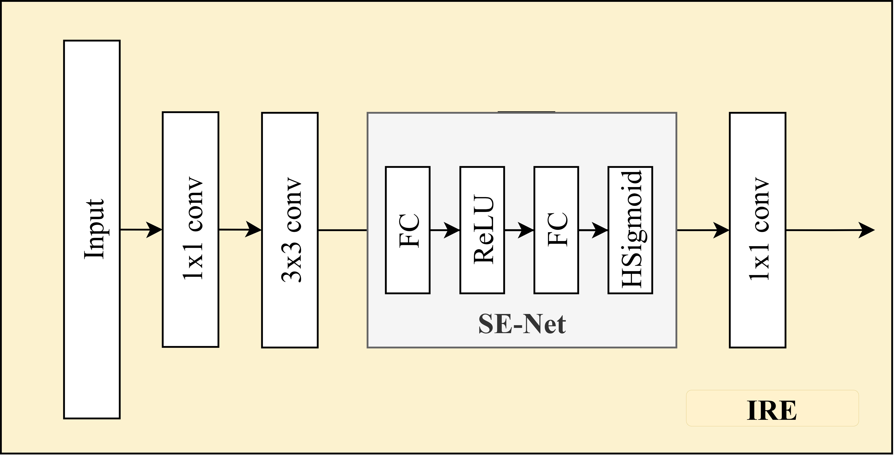
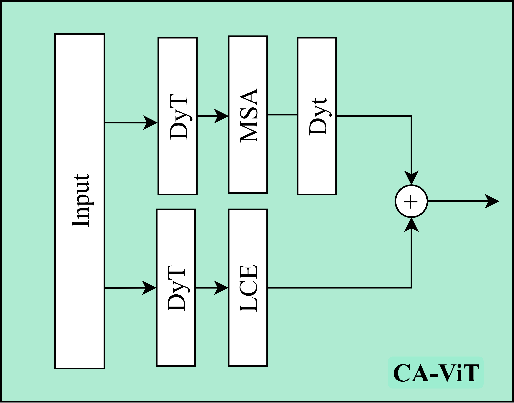
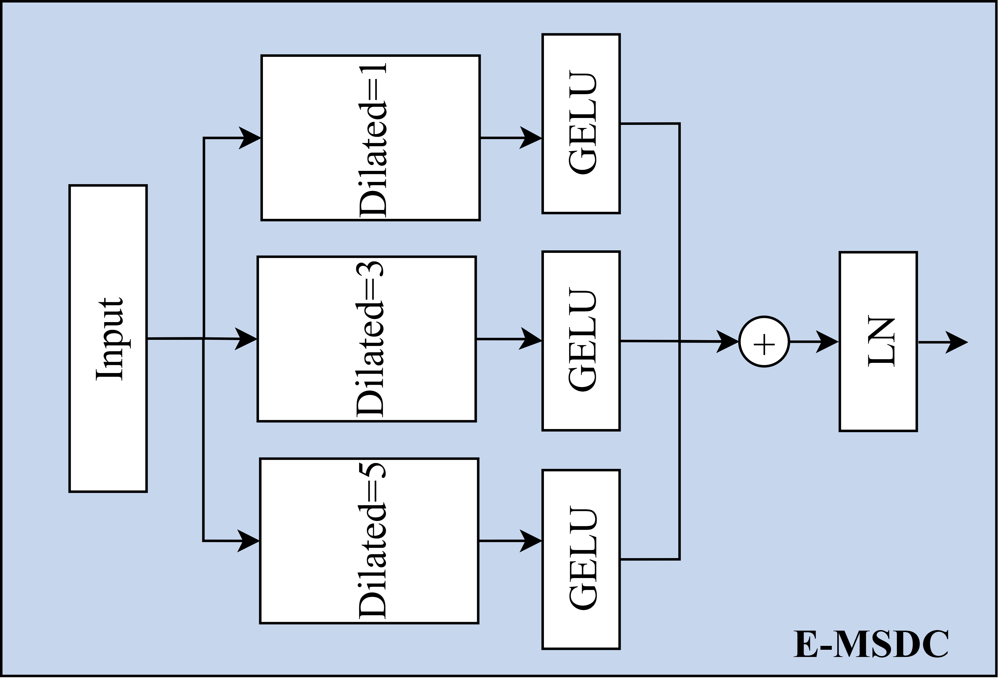
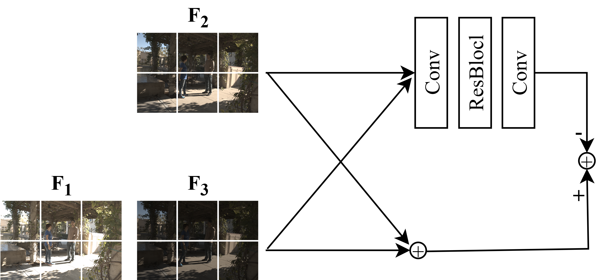
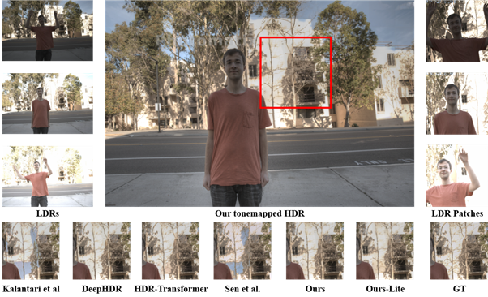

# EfficienT-HDR

## An Efficient Transformer-Based Framework via Multi-Exposure Fusion for HDR Reconstruction

**Yu-Shen Huang, Tzu-Han Chen, Cheng-Yen Hsiao, and Shaou-Gang Miaou**

[Paper](https://arxiv.org/abs/2509.19779)

## Overview

EfficienT-HDR is a lightweight Transformer-based framework for
HDR reconstruction from three LDR images captured at different
exposures. It aims to reduce computational cost while mitigating
ghosting artifacts caused by motion between exposures.

Building on HDR-Transformer, the framework combines YCbCr-based
input processing, adaptive feature fusion, and efficient
Transformer components.

The paper presents two variants:

- **EfficienT-HDR:** balances reconstruction quality and efficiency.
- **EfficienT-HDR-Lite:** further reduces computation through a
  streamlined feature fusion strategy.

### Key Results

Compared with HDR-Transformer, the main model achieves:

- Approximately **67% fewer FLOPs**: 21.61 G → 7.04 G.
- Approximately **5.27× faster ONNX CPU inference per patch**:
  662.68 ms → 125.81 ms.
- Approximately **2.51× faster Jetson Xavier NX inference per patch**:
  2151.68 ms → 857.55 ms.
- A higher **HDR-VDP-2** score: 64.63 → 65.09.

These improvements involve a quality–efficiency tradeoff:
PSNR and SSIM are lower than those of HDR-Transformer, while
HDR-VDP-2 is higher.

*Sources: Tables I–III of the paper. Speedup ratios are calculated
from the reported runtimes.*

## Overall Architecture

The framework takes underexposed, normally exposed, and
overexposed LDR images as input and reconstructs an HDR image.


*Figure 2 from the paper: Overall architecture of EfficienT-HDR.*

## Method

### YCbCr Input Processing

Input images are converted from RGB to YCbCr to separate
luminance and chrominance information before feature processing.

*Source: Section III-B of the paper.*

### Inverted Residual Embedding (IRE)

IRE uses an expansion–depthwise convolution–projection structure
with channel attention for efficient frontend feature extraction.



*Figure 4(a) from the paper.*

### Context-Aware Transformer Block

The Transformer block combines global context modeling with
local feature extraction. The lightweight design incorporates
Dynamic Tanh (DyT) and E-MSDC.



*Figure 4(b) from the paper.*

### Enhanced Multi-Scale Dilated Convolution (E-MSDC)

E-MSDC uses parallel grouped convolution branches with different
dilation rates to extract local features at multiple scales.



*Figure 4(c) from the paper.*

### Intersection-Aware Adaptive Fusion (IAAF)

IAAF learns shared information between exposure features to
support adaptive fusion and suppress ghosting artifacts.



*Figure 5 from the paper.*

## Lightweight Variant

EfficienT-HDR-Lite streamlines the frontend fusion strategy.
The main model retains additional original features, while
the Lite model uses a reduced feature concatenation to lower
the computational cost.


*Figure 9 from the paper. The differences from the main model
are highlighted in red.*

## Results

### Visual Comparison

The comparison below shows reconstructed HDR images from
different methods, with magnified regions for inspecting
motion artifacts and local details. All results use the same
tone-mapping operator for display.



*Figure 7 from the paper.*

### Reconstruction Quality

Results on the Kalantari and Ramamoorthi dataset.
Higher values indicate better performance.

| Model | PSNR-l ↑ | SSIM-l ↑ | PSNR-μ ↑ | SSIM-μ ↑ | HDR-VDP-2 ↑ |
|---|---:|---:|---:|---:|---:|
| HDR-Transformer | 39.252 | 0.9885 | 42.719 | 0.9919 | 64.63 |
| Sen12 | 38.110 | 0.9721 | 40.800 | 0.9808 | 59.38 |
| Kalantari17 | 38.158 | 0.9775 | 38.737 | 0.9807 | 63.21 |
| DeepHDR | 32.703 | 0.9002 | 31.058 | 0.8499 | 59.39 |
| EfficienT-HDR | 38.539 | 0.9856 | 41.487 | 0.9891 | 65.09 |
| EfficienT-HDR-Lite | 38.200 | 0.9854 | 41.060 | 0.9888 | 64.88 |

*Source: Table I of the paper. “Ours” and “Ours-Lite” are
displayed here as EfficienT-HDR and EfficienT-HDR-Lite.*

### Computational Efficiency

Lower values indicate lower computational cost or latency.

| Model | FLOPs (G) ↓ | Parameters (M) ↓ | GPU (ms/image) ↓ | CPU (ms/patch) ↓ |
|---|---:|---:|---:|---:|
| HDR-Transformer | 21.61 | 1.22 | 94.43 | 662.68 |
| Kalantari17 | 12.57 | 0.39 | 2.81 | 28.85 |
| DeepHDR | 7.11 | 16.61 | 6.32 | — |
| EfficienT-HDR | 7.04 | 1.14 | 66.55 | 125.81 |
| EfficienT-HDR-Lite | 5.98 | 1.07 | 66.26 | 116.06 |

*Source: Table II of the paper. CPU measurements use ONNX
on an Intel Core i7-11800H and are reported per patch.
GPU measurements are reported per image; these units should
not be compared directly.*

### Edge Device Performance

| Model | Jetson Xavier NX (ms/patch) ↓ |
|---|---:|
| HDR-Transformer | 2151.68 |
| EfficienT-HDR | 857.55 |
| EfficienT-HDR-Lite | 800.47 |

*Source: Table III of the paper. These measurements represent
per-patch latency, rather than full-resolution image latency.*

## Experimental Setup

The paper reports the following training configuration:

| Setting | Value |
|---|---|
| Framework | PyTorch |
| Dataset | Kalantari and Ramamoorthi |
| Training/testing sequences | 74 / 10 |
| Training patch size | 128 × 128 |
| Optimizer | AdamW |
| Initial learning rate | 1 × 10⁻⁴ |
| Weight decay | 2 × 10⁻² |
| Learning rate scheduler | Cosine Annealing Warm Restarts |
| Epochs | 100 |
| Batch size | 14 |
| Loss | Joint Recon Perceptual Loss |

*Source: Section IV-A of the paper. These are the paper's
experimental settings; individual scripts in the current
repository may contain different defaults.*

## Code and Reproduction Status

This repository contains research code and experimental versions.
It is currently being organized to clarify:

- The mapping between model files and the paper's final variants.
- The corresponding pretrained checkpoints.
- The tested software environment and dependencies.
- Reproducible training, evaluation, and ONNX export commands.

The tables above reproduce the paper's reported results.
They are not new benchmark runs of the current repository.

## Citation

If you find this work useful, please cite:

```bibtex
@article{huang2025efficienthdr,
  title={EfficienT-HDR: An Efficient Transformer-Based Framework via Multi-Exposure Fusion for HDR Reconstruction},
  author={Huang, Yu-Shen and Chen, Tzu-Han and Hsiao, Cheng-Yen and Miaou, Shaou-Gang},
  journal={arXiv preprint arXiv:2509.19779},
  year={2025}
}
```

## Acknowledgments

This project builds upon
[HDR-Transformer](https://github.com/ljzycmd/HDR-Transformer).
We thank the original authors and the authors of the referenced
components for making their research and implementations available.

This research was supported by Taiwan's National Science and
Technology Council (NSTC), under the College Student Research
Scholarship, grant **114-2813-C-033-037-E**.
